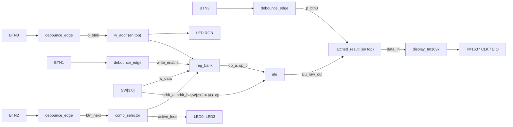

# Lab 03 – ALU + Banco de Registros + Diseño Modular

**Electrónica Digital 2 · Universidad Nacional de Colombia, Sede Bogotá**
**Plataforma:** FPGA Zybo Z7 (reloj de 125 MHz) · **Lenguaje:** Verilog · **Herramientas:** Vivado, GTKWave
**Autores:** [Juan Carlos Salcedo Cabra, Jordy Andrey Samudio Garcia, Andrés Felipe Vega Bermeo]

---

## Contenido

1. [Descripción del sistema](#1-descripción-del-sistema)
2. [Arquitectura modular](#2-arquitectura-modular)
3. [Descripción de cada módulo](#3-descripción-de-cada-módulo)
4. [Interfaz de usuario (Zybo Z7)](#4-interfaz-de-usuario-zybo-z7)
5. [Estrategia de visualización](#5-estrategia-de-visualización)
6. [Simulación (GTKWave)](#6-simulación-gtkwave)
7. [Implementación en FPGA](#7-implementación-en-fpga)
8. [Análisis de resultados](#8-análisis-de-resultados)
9. [Estructura del repositorio](#9-estructura-del-repositorio)

---

## 1. Descripción del sistema

El objetivo de la práctica es construir un **sistema digital completo** a partir de módulos independientes, siguiendo el flujo real de diseño:

> Especificación → Diseño → Simulación → Implementación

El sistema permite:

- **Almacenar** valores de 4 bits en un banco de 4 registros (R0–R3).
- **Recorrer** automáticamente las combinaciones de dos registros que sirven como operandos A y B.
- **Ejecutar** una operación aritmética o lógica en una ALU de 4 bits.
- **Mostrar** el resultado en un display TM1637 y **conservarlo** hasta que se ejecute una nueva operación.

Esto último es un requisito clave: el display solo se actualiza al presionar **BTN3**. Aunque después cambien los operandos, la combinación o la operación seleccionada, el resultado mostrado no cambia hasta la siguiente ejecución.

---

## 2. Arquitectura modular



| Módulo | Archivo | Función |
|---|---|---|
| Antirrebote + flanco | `debounce_edge.v` | Limpia cada botón y genera un pulso de 1 ciclo |
| Banco de registros | `reg_bank.v` | 4 registros de 4 bits, 1 puerto de escritura y 2 de lectura |
| Selector de combinaciones | `comb_selector.v` | Recorre las 6 parejas de registros (A, B) |
| ALU | `alu.v` | 8 operaciones aritméticas y lógicas de 4 bits |
| Driver del display | `display_tm1637.v` | Máquina de estados que habla con el TM1637 |
| Integración | `top.v` | Conecta todo y maneja los pines físicos |

---

## 3. Descripción de cada módulo

### 3.1 `debounce_edge.v` – Antirrebote y detector de flanco

Los botones mecánicos generan rebotes (varias transiciones falsas al pulsar). Este módulo hace tres cosas:

1. **Sincronizador de 2 flip-flops** (`btn_sync_0`, `btn_sync_1`): evita problemas de metaestabilidad al leer una señal asíncrona.
2. **Contador antirrebote:** solo acepta un nuevo estado del botón si la señal se mantiene distinta del estado actual durante **1 250 000 ciclos** → 1 250 000 × 8 ns = **10 ms** a 125 MHz.
3. **Detector de flanco ascendente:** `pulse = btn_state & ~btn_state_d`. Entrega un único pulso de un ciclo de reloj por cada pulsación, sin importar cuánto tiempo se mantenga presionado el botón.


### 3.2 `reg_bank.v` – Banco de registros

- 4 registros de 4 bits: `registers[3:0]`.
- **Escritura síncrona:** en el flanco de subida de `clk`, si `write_enable = 1`, se guarda `w_data` en `registers[w_addr]`.
- **Lectura combinacional (asíncrona):** `r_data_a` y `r_data_b` siempre reflejan el contenido de los registros indicados por `r_addr_a` y `r_addr_b`.
- Reset asíncrono que pone todos los registros en `0000` (en `top.v` está conectado a `0`, por lo que no se usa).

### 3.3 `comb_selector.v` – Selector de combinaciones

Un contador interno `index` (0 a 5) avanza con cada pulso de `btn_next` y vuelve a 0 después de la combinación 5. Según el índice, entrega las direcciones de los operandos y qué LEDs encender:

| index | Operando A | Operando B | `active_leds` (LED3..LED0) |
|:-:|:-:|:-:|:-:|
| 0 | R0 | R1 | `0011` |
| 1 | R0 | R2 | `0101` |
| 2 | R0 | R3 | `1001` |
| 3 | R1 | R2 | `0110` |
| 4 | R1 | R3 | `1010` |
| 5 | R2 | R3 | `1100` |

Son las 6 combinaciones posibles de elegir 2 registros entre 4 (C(4,2) = 6), y cada LED encendido corresponde a un registro activo.

### 3.4 `alu.v` – Unidad Aritmético-Lógica

Recibe dos operandos de 4 bits (`A`, `B`) y un código de operación de 3 bits (`alu_op`). La salida es de 8 bits (los 4 bits altos en cero), lo que deja espacio para mostrarla en dos dígitos hexadecimales.

| `alu_op` | Operación | Expresión |
|:-:|---|---|
| `000` | Suma | `A + B` |
| `001` | Resta | `A - B` |
| `010` | AND | `A & B` |
| `011` | OR | `A \| B` |
| `100` | XOR | `A ^ B` |
| `101` | NOT A | `~A` |
| `110` | Desplazamiento a la izquierda | `A << 1` |
| `111` | Desplazamiento a la derecha | `A >> 1` |

**Observaciones de diseño:**

- Es lógica puramente **combinacional** (`always @(*)`), sin reloj.
- La suma y la resta se calculan en 4 bits, por lo que el resultado es **módulo 16** (no se muestra el acarreo). Ejemplo: `3 - 5` da `0xE` (14), que equivale a −2 en complemento a 2 de 4 bits.
- El desplazamiento a la izquierda también se trunca a 4 bits (el bit más significativo se pierde).

### 3.5 `display_tm1637.v` – Driver del display

El TM1637 usa un protocolo serie de **dos hilos** (CLK y DIO) parecido a I2C, pero sin dirección de esclavo. El módulo:

1. **Divide el reloj** de 125 MHz hasta un `bus_clk` de ~**50 kHz** (se invierte cada 1250 ciclos → periodo de 20 µs).
2. **Decodifica** cada nibble hexadecimal a segmentos con la función `hex_to_7seg` (0–9 y A–F).
3. Ejecuta una **máquina de estados** que envía, en bucle continuo, tres comandos al TM1637:

| Etapa | Estados | Byte enviado | Significado |
|---|---|---|---|
| 1 | 1 – 9 | `0x40` | Comando de datos: auto-incremento de dirección |
| 2 | 10 – 38 | `0xC0` + 4 bytes | Dirección inicial del primer dígito y datos de los 4 dígitos |
| 3 | 39 – 47 | `0x8F` | Display encendido con brillo máximo |

Cada byte se envía **bit a bit, LSB primero**, seguido de un ciclo de ACK; cada comando empieza con una condición de **START** y termina con **STOP**.

Después de un pequeño retardo de encendido (estado 0), la máquina vuelve al estado 1 y refresca el display continuamente, de modo que cualquier cambio en `data_in` se refleja en el siguiente ciclo de refresco.

### 3.6 `top.v` – Módulo superior

Solo integra los módulos y contiene lógica mínima, como pide la guía:

- **4 instancias de `debounce_edge`**, una por botón.
- **`w_addr`:** contador de 2 bits que incrementa con `p_btn0` y selecciona el registro de escritura (R0 → R1 → R2 → R3 → R0…).
- **LED RGB:** decodifica `w_addr` en un color para indicar el registro destino.

| Registro de escritura | Color del LED RGB |
|:-:|:-:|
| R0 | Rojo |
| R1 | Verde |
| R2 | Azul |
| R3 | Amarillo (rojo + verde) |

- **`latched_result`:** registro de 8 bits que **solo se actualiza cuando `p_btn3 = 1`**. Es lo que garantiza que el display conserve el último resultado.

```verilog
always @(posedge clk) begin
    if (p_btn3)
        latched_result <= alu_raw_out;
end
```

---

## 4. Interfaz de usuario (Zybo Z7)

| Elemento | Función |
|---|---|
| `SW[3:0]` | Dato de 4 bits que se escribe en el registro |
| `SW[2:0]` | Selección de la operación de la ALU |
| `BTN0` | Selecciona el registro de escritura (R0 → R3) |
| `BTN1` | Escribe `SW[3:0]` en el registro seleccionado |
| `BTN2` | Cambia la combinación de operandos (A, B) |
| `BTN3` | Ejecuta la ALU y actualiza el display |
| `LED0..LED3` | Indican los registros activos como operandos (LED0 = R0 … LED3 = R3) |
| LED RGB | Indica el registro seleccionado para escritura |
| TM1637 | Muestra el resultado de la última operación ejecutada |


---

## 5. Estrategia de visualización

El resultado se muestra en **hexadecimal, en los dos dígitos de la derecha** del display:

| Dígito 1 (izq.) | Dígito 2 | Dígito 3 | Dígito 4 (der.) |
|:-:|:-:|:-:|:-:|
| apagado | apagado | `data_in[7:4]` | `data_in[3:0]` |

**Justificación:**

- La ALU entrega 8 bits, que caben exactamente en 2 dígitos hexadecimales.
- Un único sistema de representación para todas las operaciones evita confusiones.
- Hexadecimal permite leer directamente los resultados de las operaciones lógicas (AND, OR, XOR, NOT, desplazamientos), que son operaciones bit a bit.
- Para suma y resta de 4 bits (valores de 0 a F) el resultado también se interpreta directamente; recuerde que es **módulo 16**.

---

## 6. Simulación (GTKWave)

La guía exige un testbench del sistema completo **antes** de pasar a la FPGA. El testbench debe verificar:

- Escritura correcta en el banco de registros.
- Generación correcta de las combinaciones de operandos.
- Funcionamiento de las 8 operaciones de la ALU.
- Actualización del resultado al ejecutar una operación.
- Conservación del último resultado mientras no haya una nueva ejecución.


### Capturas de GTKWave


---

## 8. Implementación en FPGA

### Evidencia de funcionamiento

> _Agregar fotos o video del montaje funcionando._
>
> ``

---

## 9. Análisis de resultados

- **Diseño modular:** cada bloque se probó por separado y `top.v` solo conecta señales, lo que facilitó depurar y reutilizar módulos.
- **Antirrebote:** sin el filtro de 10 ms y el detector de flanco, una pulsación generaba varios incrementos o escrituras; con él, cada pulsación produce exactamente una acción.
- **Conservación del resultado:** el registro `latched_result` separa la salida combinacional de la ALU de lo que se muestra, cumpliendo el requisito de mantener el último resultado.
- **Aritmética de 4 bits:** la suma y la resta no conservan el acarreo ni el signo; se interpretan módulo 16. Una mejora posible sería usar el bit 4 del resultado (que hoy siempre es 0) para mostrar el acarreo o el signo.
- **Switches compartidos:** como `SW[2:0]` sirve tanto de dato como de operación, el usuario debe reconfigurarlos entre escribir y ejecutar; una alternativa sería usar switches distintos o un registro de operación.
- **Display TM1637:** la máquina de estados refresca el display continuamente, por lo que no se necesita una señal de "nuevo dato".

---

## 10. Estructura del repositorio

```
lab03/
├── src/
│   ├── top.v
│   ├── alu.v
│   ├── reg_bank.v
│   ├── comb_selector.v
│   ├── debounce_edge.v
│   └── display_tm1637.v
├── constraints/
│   └── zybo_z7.xdc
├── img/
└── README.md
```

---

